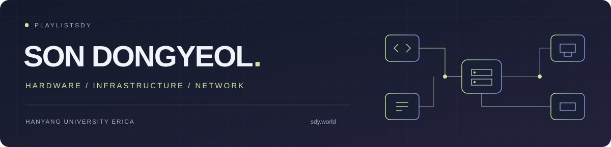

  

  
  
  
  
  

## 👤 About

- **손동열 · Son Dongyeol**
- 한양대학교 ERICA 컴퓨터학부 재학
- 하드웨어 유지보수 · 인프라 구축·운영 · 가상화 환경 설계·구성
- 아두이노 관련 대학 수업 조교

## 🧩 Projects

| 프로젝트 | 진행 · 담당 |
| :--- | :--- |
| **[ZOJ](https://zoj.kr)** | Zerone Online Judge · 기획, 채점 서버 구축, 인프라·배포·운영 담당 |
| **[ZOJ Editor](https://editor.zoj.kr)** | 문제 제작·검증 도구 · 생성기, validator, checker, 반례 탐색 |
| **ZOJ AI 검증 에이전트** | 문제 자료 조회·반례 검증·실제 채점 연동 |
| **[ZERONE](https://zerone01.kr)** | 학회 통합 관리 웹 · 운영 흐름 설계, 서버·인프라 담당 |
| **[SDY.CODER](https://coder.sdy.world)** | 웹 코드 에디터 · 다중 언어 실행 환경 구성·운영 |
| **[EFOO](https://에리카밥.com)** | 학식·주변 식당 정보 앱 · 팀장, 기획 담당 |
| **[NMIXX](https://nmixx.net)** | 팬 콘텐츠·사진 검색·방송 아카이브 웹 구축·운영 |

### 🖥 Homelab

- **현재 운영 중인 모든 서비스 자체 호스팅**
- 부품 선정·조립·수리 · OS·하이퍼바이저·VM 구성 · 네트워크 구축 · 서비스 배포·운영
- Xeon · Proxmox · OPNsense · Docker · Nginx · NAS · Tailscale

### 🔗 Small tools

[**Short**](https://go.sdy.world) — 단축 URL·QR 코드 생성 도구 개발  
[**Note**](https://note.sdy.world) — 텍스트·코드 협업 노트 개발

## 📌 Experience

| 연도 | 활동 |
| :---: | :--- |
| **2026** | ZOJ · ZOJ Editor · AI 검증 에이전트 개발 |
| | COSS&SDU 성과공유 포럼 — ZOJ 발표 |
| | HEPC 대회 주관 · ZOJ 채점 인프라 운영 |
| | ZOAC 전체 총괄 — 대회 운영 준비 |
| | 영과일 13대 학회장 |
| | 자람 서버관리자 임원진 |
| | 아두이노 관련 대학 수업 조교 |
| **2025** | MAKE YOUR ERICA — EFOO 팀장 출전 |
| | 영과일 임원진 |
| **2023** | 광주고 알리미 + 지금 우리의 학교 챗봇 개발 |
| | NMIXX 웹 개발 |

## 🏅 Awards

| 연도 | 대회 · 작품 | 수상 |
| :---: | :--- | :---: |
| **2025** | 한양대학교 ERICA와 함께 만드는 안산의 내일 AI 융합 아이디어톤 | **우수상** |
| **2020** | 교내대회 · LiDAR 활용 시각장애인 보행 보조 도구 | **최우수상** |
| **2019** | 교내대회 · 다물이 | **최우수상** |
| | 제41회 경기도학생과학발명품경진대회 · 다물이 | **최우수상** |

## 🛠 Stack

**Infrastructure · Hardware**  

---

[프로젝트 상세 · 전체 이력 ↗](https://sdy.world)
